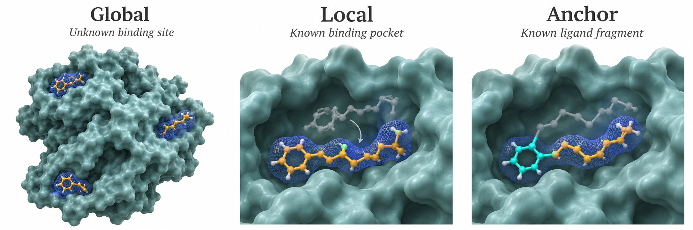

# CryoDiffDock

Fit small-molecule ligands into experimental cryo-EM density with diffusion-based docking and physics-aware refinement.

[Quick start](#quick-start) · [Docking modes](#choose-a-docking-mode) · [Run your own data](#run-your-own-data) · [View results](#view-results) · [Paper reproduction](#paper-reproduction)

## Quick start

Use a Linux machine with an NVIDIA GPU and Conda, Mamba, or Micromamba. The installer creates a CUDA 11.7 environment, downloads the [523 MiB model-weight bundle](https://github.com/YYYYYunsen/CryoDiffDock/releases/tag/weights-v1.0.0), verifies its SHA-256 checksum, and places the weights and YAML configurations in `checkpoints/`.

```bash
git clone https://github.com/YYYYYunsen/CryoDiffDock.git
cd CryoDiffDock
./install.sh
conda activate cryodiffdock
cryodiffdock demo
```

The demo runs known-pocket Local docking on [9CF5](examples/9CF5/README.md). Open the printed **`report.html`** path to see the predicted pose and its symmetry-corrected RMSD against the deposited ligand. The archived benchmark result is 1.24 Å. The report shows the RMSD measured in the new run alongside that value.

<details>
<summary>Installation checks and offline weights</summary>

- Run `cryodiffdock doctor` to check dependencies and installed checkpoints.
- Run `cryodiffdock demo --check` to validate the example inputs, Local weights, and CUDA before docking.
- If you already have the ZIP, run `./install.sh --weights /path/to/cryodiffdock-weights-v1.0.0.zip`.
- If you used Mamba or Micromamba, activate `cryodiffdock` with that manager. The original engine environments are available in [`environment-local.yml`](environment-local.yml) and [`environment-global.yml`](environment-global.yml).

</details>

## Choose a docking mode



*Conceptual illustration. The turquoise fragment in Anchor marks the supplied restraint.*

| What do you know? | Mode | What you get |
| --- | --- | --- |
| The binding site is unknown | [Global](#global) | Ranked candidate sites and ligand poses across the receptor |
| The pocket center is known | [Local](#local) | A full-ligand pose fitted to local density and physically refined |
| A fragment already has a placed pose | [Anchor](#anchor-a-known-ligand-fragment) | Candidate poses for the full ligand with the supplied fragment restrained |
| The binding site is unknown and you want a refined pose | [Cascade](#cascade) | A selected pose after Local refinement at the highest-ranked Global sites |

## Run your own data

Supply a receptor **PDB**, ligand chemistry as an **SDF**, and an experimental **MRC/CCP4 map**. Keep the receptor, map, and any supplied fragment in the same Cartesian coordinate frame. Use a **full map** for Global and Cascade. For Local and Anchor, use **segmented ligand density or a protein-subtracted residual map**. Local and Anchor also accept a prepared Cartesian density crop as an NPZ.

### Global

Search the full receptor when the pocket is unknown. If the docking receptor is cropped or omits chains, use `--mask-structure` to provide the full deposited model for density masking.

```bash
cryodiffdock global \
  --name example \
  --protein receptor.pdb \
  --mask-structure full_model.cif \
  --ligand ligand.sdf \
  --map full_map.mrc \
  --output outputs/example_global
```

Global builds the scalar and vector shell features, samples poses, and ranks candidates using confidence and map agreement. Read `ranking/global_scores.csv` for the ranking and `poses/` for the pose files.

### Local

Fit the whole ligand within a known pocket. Pass the pocket center as **X Y Z in Å** in the map coordinate frame.

```bash
cryodiffdock local \
  --name example \
  --protein receptor.pdb \
  --ligand ligand.sdf \
  --map ligand_residual.mrc \
  --center 12.4 -3.1 28.7 \
  --output outputs/example_local
```

Local samples baseline and density-guided poses with a rigid receptor by default, ranks their union by map agreement, and runs hierarchical search followed by physical refinement. Conditional repair can adjust nearby side chains. The final pose is `final_pose.sdf` and stage records are under `paahs/`.

<details>
<summary>Local sampling and refinement options</summary>

- Use `--flexible-sidechains A:10-A:14` to enable flexible sampling for specified residues.
- Use `--no-paahs` to stop at the earlier V2 search output under `search/v2_selected/`.
- Use `cryodiffdock paahs` to refine an existing search ensemble. The [physical refinement workflow](docs/PAAHS_PUBLIC_WORKFLOW.md) documents the required manifests and score tables.

</details>

### Anchor a known ligand fragment

Use experimental density to fit the free part of a ligand while restraining a placed fragment. Anchor is an experimental mode.

```bash
cryodiffdock anchor \
  --protein receptor.pdb \
  --ligand full_ligand.sdf \
  --reference placed_fragment.sdf \
  --anchor-atoms 6 8 9 10 11 12 \
  --map ligand_residual.mrc \
  --output outputs/anchored
```

Replace the example indices with **one-based heavy-atom indices in the full ligand SDF**, listed in the same order as the heavy atoms in the reference fragment. Use at least three non-collinear anchor atoms and leave part of the ligand free. Run with `--check` to validate the mapping and inputs before sampling.

Anchor restricts torsions that would deform the placed fragment and guides the free atoms against density. Candidate screening checks anchor deviation, receptor clashes, stereochemistry, and coverage by the map. The default maximum anchor deviation is **0.5 Å per atom**. If all candidates fail, the report shows **Needs review** and lists the reasons.

<details>
<summary>Exit torsion scan and local density refinement</summary>

Add `--exit-dihedrals EXIT NEXT` to run restrained repair, a two-bond torsion scan, and local density refinement after sampling. Each dihedral takes four comma-separated, one-based heavy-atom indices. Point the first central bond from the anchor toward the free fragment and choose the next rotatable bond in the same direction. The indices depend on your ligand.

- Increase `--box-size` for a long ligand or supply an NPZ crop that covers the free fragment.
- With a cropped inference receptor, pass the full receptor as `--clash-protein` for steric guidance and screening.
- Add `--reuse-sampling PATH_TO_PREVIOUS_OUTPUT` with the same inputs and a new `--output` to refine existing samples on CPU. Use `--refinement-threads` to parallelize the exit scan.

The report links both `candidate_scores.csv` and `refined_scores.csv`. Anchor deviation measures agreement with the supplied restraint. Density scores measure fit to the same map used during optimization.

</details>

### Cascade

Start with an unknown pocket and refine the poses from the five highest-ranked Global sites.

```bash
cryodiffdock cascade \
  --name example \
  --protein receptor.pdb \
  --mask-structure full_model.cif \
  --ligand ligand.sdf \
  --map full_map.mrc \
  --output outputs/example_cascade
```

Cascade compares the Local branches with the original Global pose using shared density crops. It writes the selected `final_pose.sdf` and the branch scores and selection records under `selector/`. For the older single-site Global-to-Local workflow, use `--rank1-only`.

## View results

For the **demo** and **Anchor**, open `report.html` in a browser and launch `view.cxc` in ChimeraX to inspect the pose and map together. The predicted ligand is orange and the supplied reference is cyan. For **Local**, **Global**, and **Cascade**, use the paths below from the directory you passed to `--output`.

| Mode | Start here |
| --- | --- |
| Demo | `report.html`, `view.cxc`, `final_pose.sdf` |
| Global | `ranking/global_scores.csv`, `poses/` |
| Local | `final_pose.sdf`, `paahs/` |
| Anchor | `report.html`, `candidate_scores.csv`, `refined_scores.csv` when refinement is enabled |
| Cascade | `final_pose.sdf`, `selector/` |

If a **demo** or **Anchor** run fails, open the report for the failing stage and suggested next step, or inspect `run.log` for details. The demo creates a fresh output directory automatically. To choose a destination, pass `--output` with a new or empty directory.

## Paper reproduction

- [Frozen inference settings](configs/paper_inference.json) record the sampling and search parameters.
- [Physical refinement workflow](docs/PAAHS_PUBLIC_WORKFLOW.md) documents the frozen configurations and the input tables.
- [Evaluation scripts](evaluation/) include repeated-run, Q-score, and cross-run selection analyses. The original 173-case Q-score lock file remains pending.
- [Reproduction scripts](paper_reproduction/) cover cohort construction, leakage checks, and sharding. Supply paths through the environment variables documented in the launchers.

The five inference checkpoints and their configurations are published in the weight release. Verification against archived paper runs and the full numerical regression of the Cascade selector against Figure 7 remain pending. See the [release checklist](RELEASE_CHECKLIST.md).

<details>
<summary>Ranking details</summary>

Global computes 24 scalar and 6 vector shell channels and ranks poses using
`confidence_z + 0.5*density_mean_z + residual_shape_corr_z`. The default
Cascade selector requires an improvement in NCC over the original Global pose
at both density scales. Eligible Local branches are compared using equal-weight
reciprocal-rank fusion of Global site rank, Local basin-NCC rank, and shared-map
NCC rank. The selector uses neither a reference ligand nor cohort-fitted parameters.

</details>

## Citation and credits

Please cite the upstream DiffDock and DiffDock-Pocket work when using this software. See [third-party credits](THIRD_PARTY.md) and the [license](LICENSE). The CryoDiffDock citation will be added once a persistent manuscript identifier is available.

<details>
<summary>Graphical abstract</summary>


</details>
