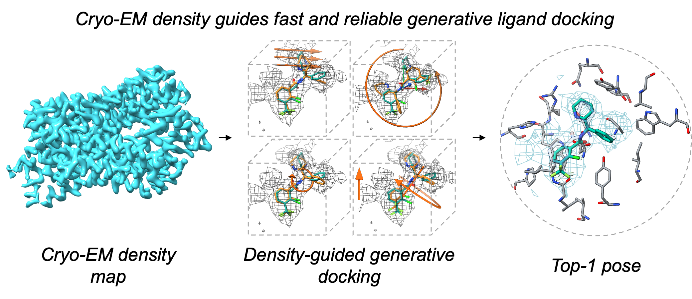

# CryoDiffDock



CryoDiffDock combines generative molecular docking with experimental cryo-EM
density. This release tree contains the code paths for:

- **CryoDiffDock-Local**: known-pocket diffusion, late-stage density guidance,
  density/confidence reranking, hierarchical search, and final lazy PAAHS
  physical refinement.
- **CryoDiffDock-Global**: site-agnostic diffusion conditioned on scalar and
  vector cryo-EM ring features.
- **CryoDiffDock-Cascade**: Global Top-5 site proposals followed by the frozen
  Local refinement protocol.

## Release status

The source code has been assembled into a standalone repository layout. It is
not yet a complete archival release: the frozen paper checkpoints, their
remaining SHA-256 values, and permanent download URLs must still be added. A
compact 6PEK/EMD-20327 smoke input is included, while its redistribution record
still needs final confirmation. See `RELEASE_CHECKLIST.md`. Do not advertise exact
paper reproducibility until the checkpoints are verified and the pending
end-to-end numerical regression tests are complete.

## Installation

CUDA 11.7 and a CUDA-capable GPU are recommended. Inference on CPU is possible
for some Local stages but is substantially slower.

Prepare a weight bundle with the layout documented in `checkpoints/README.md`,
then run the automated installer:

```bash
./install.sh --weights /path/to/cryodiffdock-weights
conda activate cryodiffdock
cryodiffdock doctor
```

After permanent checkpoint URLs are added to `checkpoints/manifest.json`,
`./install.sh` without `--weights` will download and verify them automatically.

`environment-local.yml` and `environment-global.yml` retain the original engine
environments for debugging version-sensitive behavior.

## Inputs

All modes require a receptor structure in PDB coordinates, ligand chemistry as
an SDF, and an experimental MRC/CCP4 map in the same coordinate frame. Local
also requires a pocket center. The map supplied to Local should be segmented
ligand density or a protein-subtracted residual map; using an unprocessed full
map changes the method's input condition.

## Local

```bash
cryodiffdock local \
  --name example \
  --protein receptor.pdb \
  --ligand ligand.sdf \
  --map ligand_residual.mrc \
  --center 12.4 -3.1 28.7 \
  --output outputs/example_local
```

The command samples matched baseline and density-guided ensembles with a fixed
receptor, scores their union with Gaussian NCC, performs the V2 hierarchical
search, and then runs the frozen three-phase lazy PAAHS pipeline. Conditional
physical repair can adjust nearby side chains. The delivered pose is
`outputs/example_local/final_pose.sdf`; stage audits are under
`outputs/example_local/paahs/`. Use `--no-paahs` only to stop at the earlier V2
Top-1 output. Use `--flexible-sidechains A:10-A:14` to enable flexible sampling
for specified residues.

To run the same reference-free PAAHS pipeline on already generated ensembles,
use `cryodiffdock paahs` with the blind baseline/search manifests and per-pose
NCC table. The exact column contract and frozen configuration files are
documented in [the PAAHS workflow](docs/PAAHS_PUBLIC_WORKFLOW.md).

## Global

```bash
cryodiffdock global \
  --name example \
  --protein receptor.pdb \
  --mask-structure full_model.cif \
  --ligand ligand.sdf \
  --map full_map.mrc \
  --output outputs/example_global
```

This command builds the 24 scalar and 6 vector ring channels, generates the
Global pose ensemble, runs the frozen confidence model, and applies
`confidence_z + 0.5*density_mean_z + residual_shape_corr_z`. Ranked results are
written to `outputs/example_global/ranking/global_scores.csv`.

## Cascade

```bash
cryodiffdock cascade \
  --name example \
  --protein receptor.pdb \
  --mask-structure full_model.cif \
  --ligand ligand.sdf \
  --map full_map.mrc \
  --output outputs/example_cascade
```

Cascade performs Global generation and frozen ranking, takes the Global Top-5,
and derives each Local pocket centre from the predicted pose. Each Local branch
samples poses with a fixed receptor and runs V2 Local refinement. Cascade then
compares all five branch poses with the original Global pose under the same five
density crops, requires a strictly positive multiscale-NCC gain over Global, and
applies equal-weight reciprocal-rank fusion of Global site rank, Local basin-NCC
rank, and shared-map NCC rank. `final_pose.sdf` is the selected output; the blind candidate scores
and choices are under `selector/`. Use `--rank1-only` to recover the older
Global-rank-1 output. The released selector is reference-free and has no
cohort-fitted parameters. A full numerical regression of the one-command
implementation against the paper's Figure 7 archive remains on the release
checklist.

## Paper reproduction

`configs/paper_inference.json` records the main frozen inference parameters.
The final PAAHS scripts and frozen JSON configurations are under `scripts/`,
`evaluation/`, and `configs/`; Figure 5 repeated-inference, Q-score, and
cross-run selection analysis code is under `evaluation/`. The optional Q-score
selector is not part of the default Local/Cascade commands; its original
173-case lock file is not yet included. Historical cohort
construction, leakage checks, and sharding scripts remain under
`paper_reproduction/`. Server paths in historical launchers are provenance
examples and must be supplied through their documented environment variables
on another system. The new scripts do not contain server datasets or generated
results.

Run `python -m compileall src engines preprocessing scripts` as a lightweight
source check. Full smoke and numerical regression tests require the released
checkpoints and example map.

## Citation

Add the final CryoDiffDock bibliographic record here when the manuscript has a
persistent identifier. Please also retain the DiffDock and DiffDock-Pocket
citations and notices described in `THIRD_PARTY.md`.
