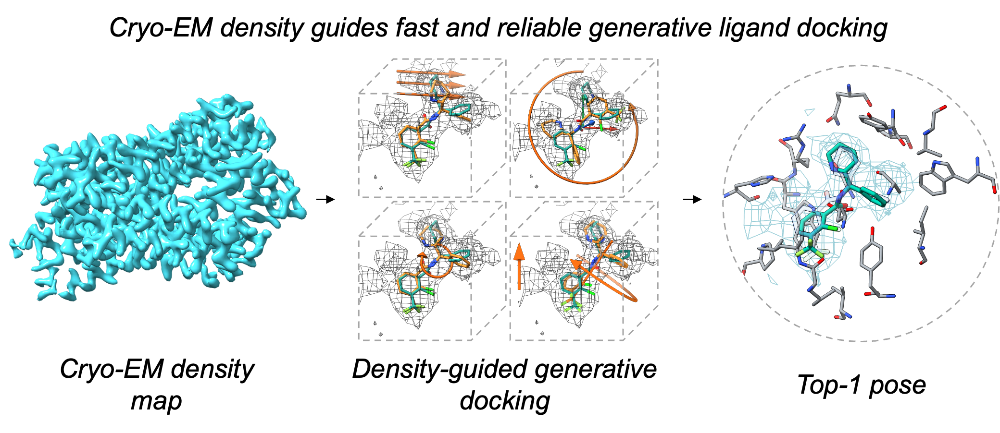

# CryoDiffDock 安装与使用



CryoDiffDock 的统一命令包含三种模式：已知口袋的 Local、未知口袋的 Global，
以及 Global Top-5 接 Local 精修的 Cascade。

## 一键安装

推荐 Linux x86_64、NVIDIA GPU 和 CUDA 11.7。先下载代码和作者发布的五组权重，
权重目录必须符合 [`checkpoints/README.md`](checkpoints/README.md) 的结构，然后运行：

```bash
git clone https://github.com/YYYYYunsen/CryoDiffDock.git
cd CryoDiffDock
chmod +x install.sh
./install.sh --weights /path/to/cryodiffdock-weights
conda activate cryodiffdock
cryodiffdock doctor
```

`install.sh` 会自动创建 Conda 环境、安装本项目、复制权重、校验文件布局和已公布的
SHA-256。当 `checkpoints/manifest.json` 填入正式下载地址后，直接运行
`./install.sh` 即可自动下载权重。

## 输入要求

- 受体结构：PDB；坐标必须与密度图一致。
- 配体：带有正确化学键和构象的 SDF。
- 密度图：MRC 或 CCP4。
- Local 还需要口袋中心 `x y z`，并推荐使用分割后的配体密度或蛋白扣除后的残差图。
- Global/Cascade 使用覆盖搜索区域的密度图；可用 `--mask-structure` 指定完整模型。

模型默认从仓库的 `checkpoints/` 读取，因此权重安装后不必反复填写模型路径。

## Local

```bash
cryodiffdock local \
  --name target \
  --protein receptor.pdb \
  --ligand ligand.sdf \
  --map ligand_residual.mrc \
  --center 12.4 -3.1 28.7 \
  --output outputs/target_local
```

默认运行冻结的 lazy PAAHS 精修；最终姿势位于
`outputs/target_local/final_pose.sdf`，各阶段审计文件位于
`outputs/target_local/paahs/`。`--no-paahs` 仅输出较早的 V2 Top-1。
已有推理结果也可使用 `cryodiffdock paahs`，所需盲态表格格式见
[`docs/PAAHS_PUBLIC_WORKFLOW.md`](docs/PAAHS_PUBLIC_WORKFLOW.md)。

## Global

```bash
cryodiffdock global \
  --name target \
  --protein receptor.pdb \
  --mask-structure full_model.cif \
  --ligand ligand.sdf \
  --map full_map.mrc \
  --output outputs/target_global
```

该命令自动构建 ring features、生成 40 个姿势、运行 Global confidence，并应用论文冻结的
`confidence_z + 0.5*density_mean_z + residual_shape_corr_z` 公式。排序表位于
`outputs/target_global/ranking/global_scores.csv`，第一行为 Global Top-1。

## Cascade

```bash
cryodiffdock cascade \
  --name target \
  --protein receptor.pdb \
  --mask-structure full_model.cif \
  --ligand ligand.sdf \
  --map full_map.mrc \
  --output outputs/target_cascade
```

该命令目前执行 Global 生成与冻结排序、提取 Top-5、从预测姿势推导口袋中心，
再运行 Local V2 分支搜索。默认按论文规则对五条分支和原始 Global 姿势
进行共享地图 NCC 评分：Local 姿势必须在两个尺度上均严格优于 Global，
随后对 Global site rank、Local basin-NCC rank 和共享 NCC rank 做等权融合。
`outputs/target_cascade/final_pose.sdf` 是最终选择的姿势，盲态选择记录在
`selector/`；`--rank1-only` 可恢复旧的 Global rank-1 输出。规则不使用
参考姿势或在该队列上拟合参数。完整的 Figure 7 数值回归仍列在发布清单中。

## 安装后自检

```bash
python scripts/verify_release.py
bash scripts/smoke_local.sh
bash scripts/smoke_global.sh
```

`verify_release.py --source-only` 只检查代码和示例是否完整，不要求安装 GPU 环境或权重。
完整 smoke test 必须在权重齐全的 CUDA 环境中运行。
